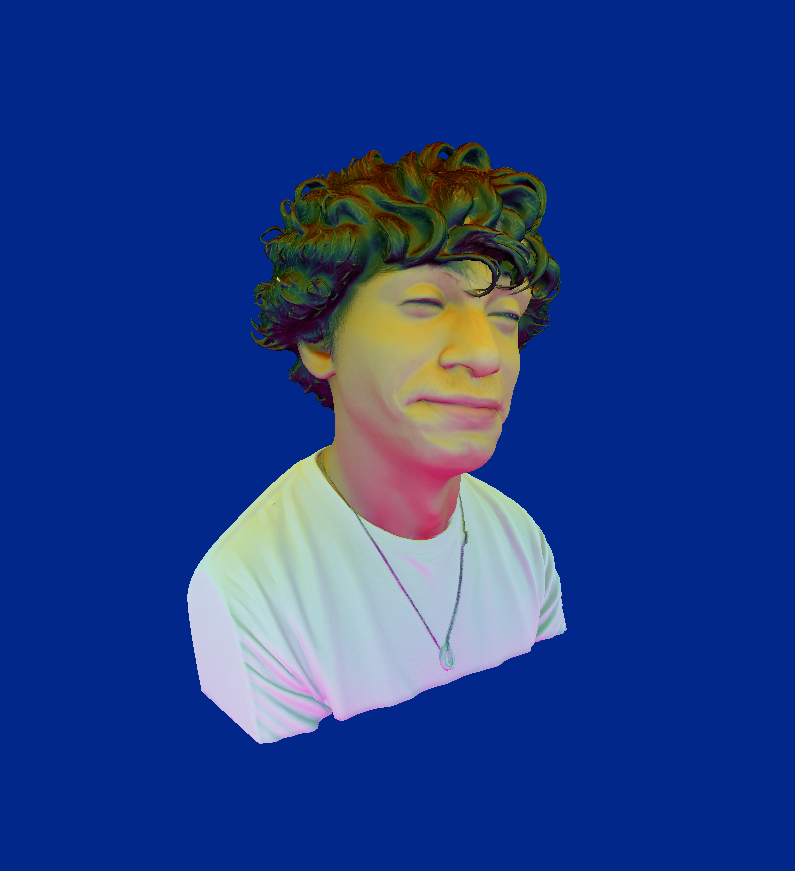
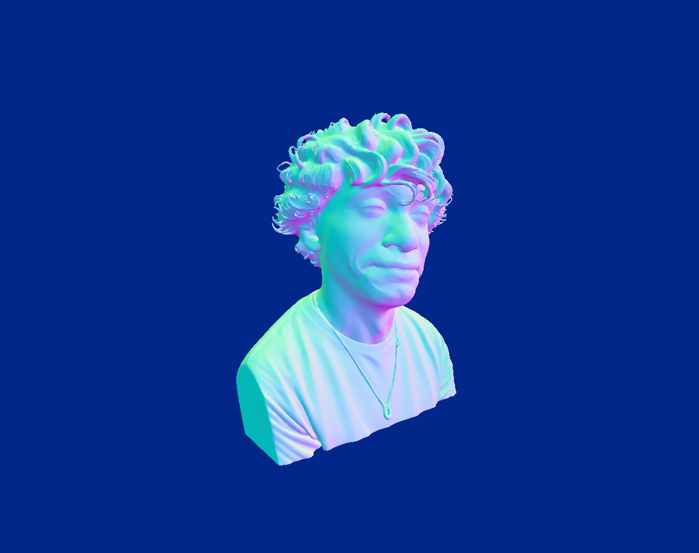

# Deferred Shading em Vulkan

Aplicação em C++17 que implementa **Deferred Shading** com a API Vulkan. A geometria é gravada em um G-Buffer e a iluminação é calculada em uma segunda passagem, sobre um triângulo que cobre a tela. O modelo de demonstração é um busto gerado por IA, com textura de cor e mapa de normal.

Repositório: https://github.com/PedroDias-2214/Deferred-Shading

## Recursos

- Render pass de dois subpasses, com G-Buffer de posição, normal, albedo/especular e profundidade.
- Iluminação com 64 luzes pontuais distribuídas em uma casca esférica e 8 luzes spot em órbita, com alcance limitado por raio.
- Leitura de modelos glTF binário (`.glb`), com geometria, normais, coordenadas de textura e tangentes.
- Mapa de normal aplicado com a base TBN calculada no fragment shader.
- Câmera em primeira pessoa, com controles de teclado e mouse.
- Redimensionamento da janela, com recriação da swapchain, do G-Buffer e dos framebuffers.
- Modos de visualização de cada canal do G-Buffer.

## Requisitos

- **Visual Studio 2026** com a carga de trabalho “Desenvolvimento para desktop com C++”
- **CMake 3.20 ou superior** (testado com 4.3.1)
- **Vulkan SDK** (testado com o loader 1.4.363)
- **GPU com suporte a Vulkan 1.3** (testado em AMD Radeon RX 580)
- **GLFW 3.5.1**, incluído em `external/GLFW`

As demais dependências já estão no repositório, na pasta `external`:

- **GLFW**: janela e superfície de apresentação (licença zlib).
- **tinygltf** (`tiny_gltf.h`): leitura de glTF e GLB (licença MIT).
- **nlohmann/json** (`json.hpp`): usado pelo tinygltf (licença MIT).
- **stb_image** (`stb_image.h`): decodificação de imagens (licença MIT ou domínio público).

Só é preciso instalar o Visual Studio e o Vulkan SDK.

## Estrutura de pastas

```
Deferred-Shading/
├── assets/models/Daniel.glb    modelo de demonstração
├── external/
│   ├── GLFW/                   include e lib
│   └── headers/                tiny_gltf.h, json.hpp, stb_image.h
├── shaders/                    shaders GLSL da técnica
├── src/                        código-fonte
├── build.ps1                   compila e executa
├── package.ps1                 gera o .zip de entrega
└── CMakeLists.txt
```

## Como compilar e executar

### 1. Clonar o repositório

```powershell
git clone https://github.com/PedroDias-2214/Deferred-Shading.git
cd Deferred-Shading
```

### 2. Compilar e executar

Na raiz do repositório:

```powershell
.\build.ps1
```

O script:
1. Configura o CMake com o gerador **Visual Studio 18 2026** (x64). Se a pasta `out` tiver uma configuração de outro gerador, ela é apagada.
2. Compila o projeto em Debug.
3. Compila os shaders para SPIR-V e copia os `.spv` para junto do executável.
4. Executa o programa.

O projeto também pode ser aberto no Visual Studio pela pasta, desde que o gerador seja o mesmo.

### Saída esperada

```
GPU selecionada: <nome da sua placa> 
Swapchain: 1280x720, 2 imagens, modo FIFO, sRGB: sim
Shader carregado: ...
G-Buffer criado: 1280x720
Modelo carregado: ... vértices, ... índices, albedo 2048x2048, normal 2048x2048
Material criado: albedo 2048x2048, normal do modelo
Pipeline gráfico criado (subpass 1, APPLY_GAMMA = 0)
Renderer criado: 2 frames em voo, 2 imagens
```
Se houver mais de uma GPU, o programa usa a primeira compatível encontrada.

## Controles

| Tecla | Função |
|---|---|
| W A S D | Andar |
| Espaço | Subir |
| Ctrl ou Shift esquerdo | Descer |
| Mouse | Olhar (com o mouse preso) |
| Tab | Solta ou prende o mouse |
| Clique esquerdo | Prende o mouse, se estiver solto |
| L | Liga ou desliga as luzes pontuais |
| K | Liga ou desliga as luzes spot |
| C | Troca a paleta das pontuais (Arco-íris, Branca, Quente, Fria) |
| = e - | Aumenta ou diminui a intensidade das luzes |
| 0 | Cena final |
| 1 | Posição (G-Buffer) |
| 2 | Normal (G-Buffer) |
| 3 | Albedo (G-Buffer) |
| 4 | Especular (G-Buffer) |
| 5 | Profundidade (G-Buffer) |
| H | Mostra a lista de comandos no terminal |
| X da janela | Fecha a aplicação |

A barra de título mostra o estado das luzes, da paleta, da intensidade e do mouse.

## Arquitetura

O renderizador usa um render pass com dois subpasses:

1. **Geometria (subpass 0):** o modelo é desenhado uma vez. O `geometry.frag` grava posição, normal, cor base e brilho em quatro imagens, e o hardware grava a profundidade. Nenhuma luz é calculada nesta etapa.
2. **Iluminação (subpass 1):** um triângulo que cobre a tela lê o G-Buffer como input attachments. O `lighting.frag` percorre a lista de luzes para cada pixel e calcula o Blinn-Phong, com atenuação por distância e cone para os spots. Depois aplica exposição, tone mapping ACES e correção gama.

O custo da iluminação cresce com o número de pixels e de luzes, e não com o número de objetos da cena.

### Shaders

Os shaders ficam em `shaders/`, em GLSL 4.50:

| Shader | Subpass | Função |
|---|---|---|
| `geometry.vert` | 0 | Transforma os vértices e monta a base TBN no espaço do mundo |
| `geometry.frag` | 0 | Amostra o material e grava o G-Buffer |
| `fullscreen.vert` | 1 | Gera o triângulo de tela cheia sem vertex buffer |
| `lighting.frag` | 1 | Calcula a iluminação a partir do G-Buffer |

O `CMakeLists.txt` compila cada shader com o `glslc` do Vulkan SDK. Por exemplo, `geometry.vert` gera `geometry.vert.spv`. Os arquivos são gerados em `shaders/spv/` e copiados para `spv/`, ao lado do executável.

### Arquivos principais

| Arquivo | Responsabilidade |
|---|---|
| `src/main.cpp` | Ponto de entrada e configuração do console (UTF-8) |
| `src/App.cpp` | Criação e destruição dos recursos, loop principal e entrada |
| `src/Config.hpp` | Tamanho da janela, validação e extensões |
| `src/Instance.cpp` | Instância Vulkan e camada de validação |
| `src/Device.cpp` | Surface, escolha da GPU, filas e dispositivo lógico |
| `src/Swapchain.cpp` | Swapchain, formato, modo de apresentação e image views |
| `src/Shaders.cpp` | Leitura dos `.spv` e shader modules |
| `src/GBuffer.cpp` | Imagens do G-Buffer |
| `src/RenderPass.cpp` | Render pass de dois subpasses e framebuffers |
| `src/Descriptors.cpp` | Layouts, pool e descriptor sets |
| `src/Buffer.cpp` | Buffers na memória visível pela CPU |
| `src/SceneData.hpp` | Estruturas da câmera e das luzes, no layout dos shaders |
| `src/Camera.cpp` | Câmera em primeira pessoa e matrizes |
| `src/Lights.cpp` | Geração das luzes e controles de luz |
| `src/GltfLoader.cpp` | Leitura do GLB, com geometria, normais, UVs e tangentes |
| `src/Material.cpp` | Texturas de cor e normal do modelo |
| `src/Mesh.cpp` | Vertex e index buffers |
| `src/GeometryPipeline.cpp` | Pipeline do subpass de geometria |
| `src/LightingPipeline.cpp` | Pipeline do subpass de iluminação |
| `src/Renderer.cpp` | Command buffers, sincronização, submissão e apresentação |

## Modelo

O arquivo `assets/models/Daniel.glb` tem 3,35 MB, com textura de cor de 2K e mapa de normal. Foi gerado por IA, com o Tripo AI, a partir de uma foto, com autorização da pessoa retratada.

Para usar outro modelo, coloque um `.glb` em `assets/models/` e troque o nome do arquivo em `App::initVulkan`.

## Limitações conhecidas

- **Sem sombras:** as luzes não projetam sombras.
- **Sem transparência:** o G-Buffer guarda uma superfície por pixel, então materiais translúcidos exigiriam um passe separado.
- **Brilho uniforme:** o fator especular é fixo para todo o material, porque não há mapa de especular.
- **Malha na memória da CPU:** os buffers de vértice e de índice ficam na memória visível pela CPU, por simplicidade. Para malhas muito grandes, o correto seria copiar para a memória da GPU com um buffer de staging.
- **Aviso LNK4098:** o `glfw3.lib` usado é compilado com o runtime de Release. O programa roda, mas o aviso aparece na compilação.

## Referências

- Hargreaves, S.; Harris, M. *Deferred Shading*. NVIDIA Developer Conference, 2004.
- Policarpo, F.; Fonseca, F. *Deferred Shading Tutorial*. PUC-Rio, 2005.
- Narkowicz, K. *ACES Filmic Tone Mapping Curve*, 2015.
- The Khronos Group. *Vulkan 1.3 Specification*. https://registry.khronos.org
- Repositórios das bibliotecas: GLFW, tinygltf (syoyo), nlohmann/json e stb (nothings).

## Capturas



